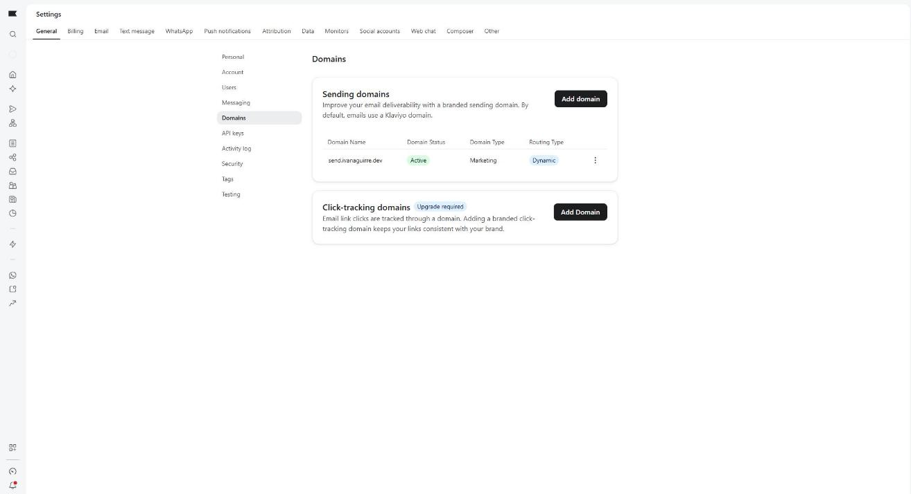
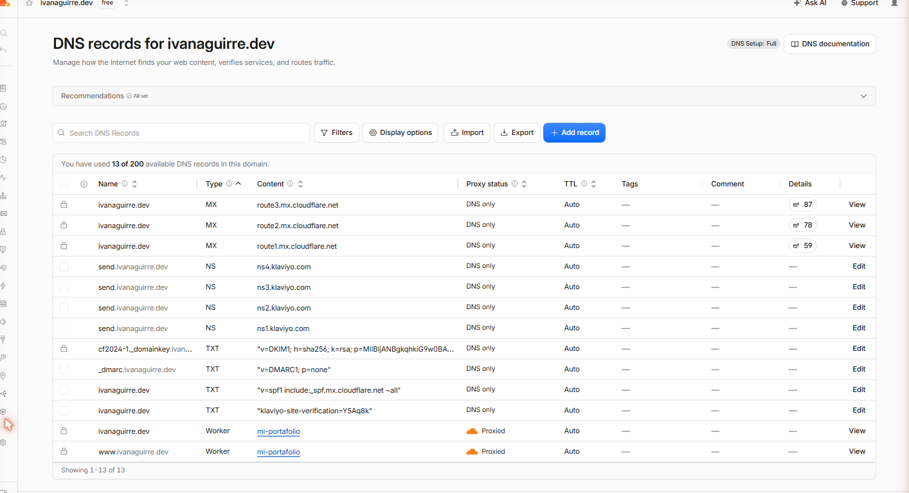
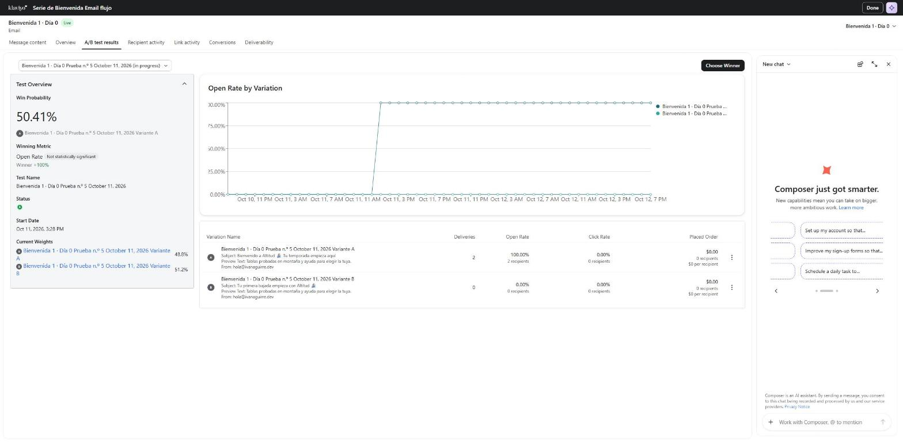
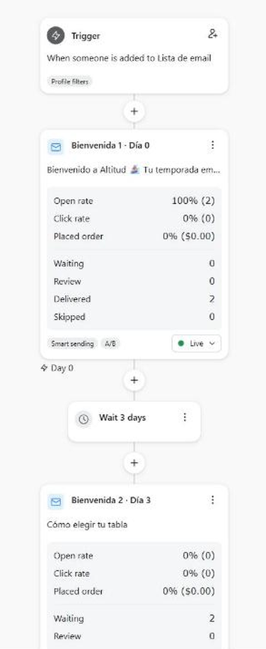
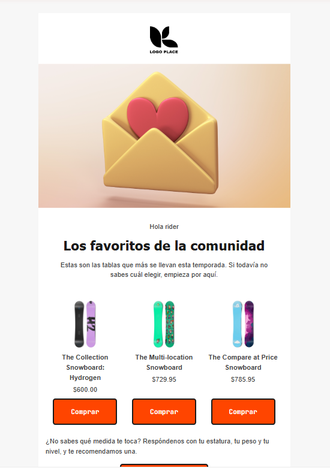
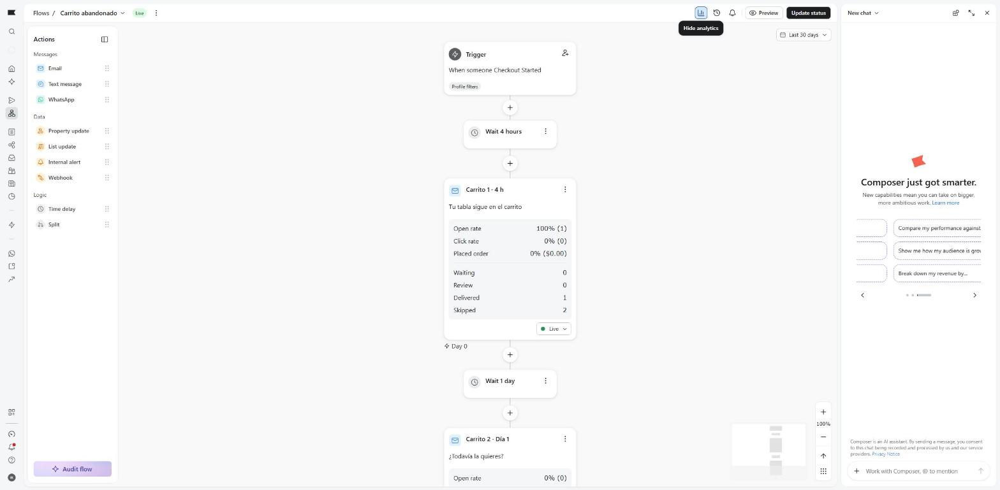
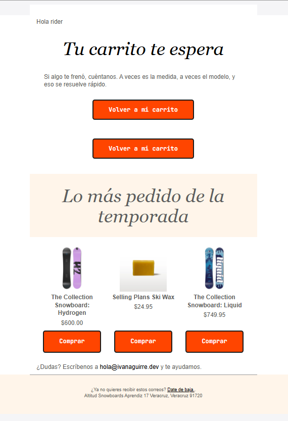
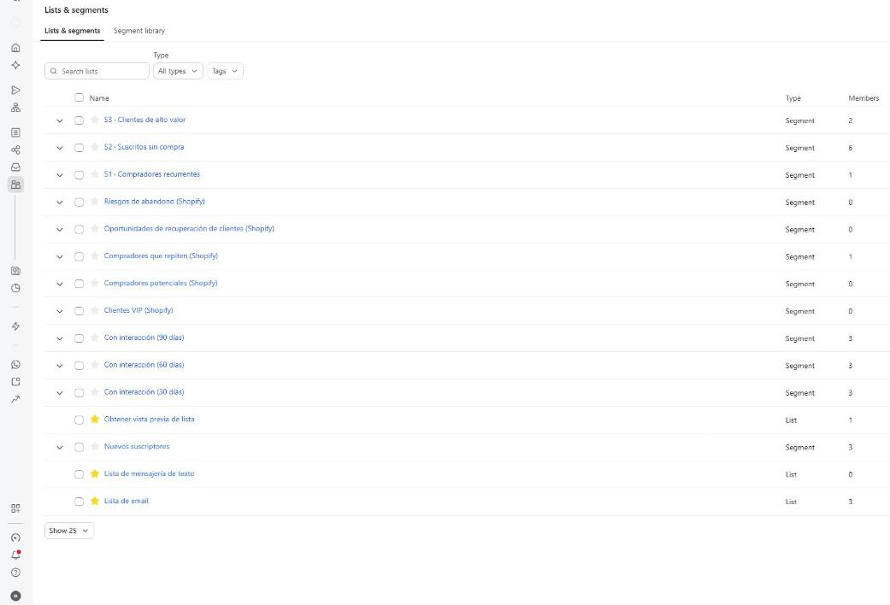
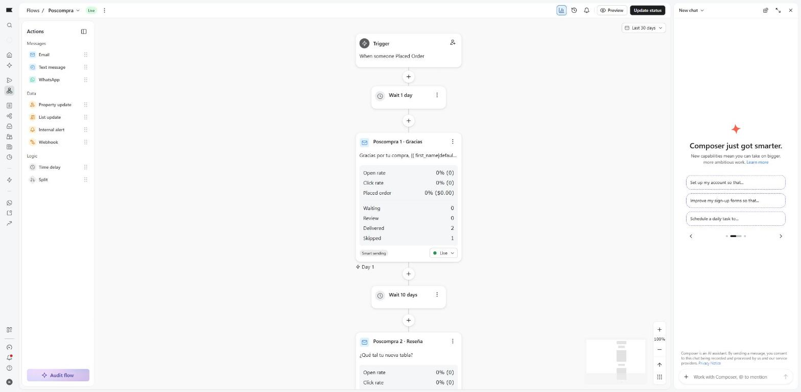

I'm Ivan, a web developer in Veracruz, Mexico. This is a Klaviyo account connected to a Shopify development store ("Altitud Snowboards", stocked with 17 test snowboards) that I set up to show how I work: deliverability, flows, segments and copy. The store has no real customers; what you see is how it's built and why.

I write emails in English or Spanish. This store happens to be Spanish, so names and subject lines are quoted the way they appear in the account, with an English gloss.

## 1. What this does for a store
- **Email sent from your own domain**, signed with SPF and DKIM instead of a shared sender, which helps it reach the inbox rather than spam.
- **Welcome, abandoned-cart and post-purchase flows that run on their own**, in your brand's voice, and stop reminding people once they buy. Shopify still sends the order and shipping notifications.
- **Segments ready for campaigns:** repeat buyers, subscribers who never bought, and high-value customers.

## 2. Deliverability

- **Own domain:** `ivanaguirre.dev` (Cloudflare).
- **Klaviyo sending domain:** `send.ivanaguirre.dev`, delegated to Klaviyo via NS records; Klaviyo's SPF and DKIM sit on my domain, not on theirs. Status: verified and active.

- **DMARC:** `p=none` published to start collecting reports; once the reports come back clean, the next step is `p=quarantine`.

- **Sender:** Altitud Snowboards `<hola@ivanaguirre.dev>`, a real mailbox (Cloudflare Email Routing): if a customer replies, someone reads it.

## 3. Flows

### Welcome series (live)
- **Trigger:** subscribes to "Lista de email" (the email list). **Filter:** has placed no order since entering the flow. Anyone who buys drops out of the series.
- **Email 1 · day 0:** a welcome and what the store offers. **Subject-line A/B test:** A "Bienvenido a Altitud 🏂 Tu temporada empieza aquí" ("Welcome to Altitud 🏂 Your season starts here", brand-led) vs. B "Tu primera bajada empieza con Altitud 🏂" ("Your first run starts with Altitud 🏂", the rider's benefit); open rate picks the winner.

- **Wait 3 days → Email 2:** "Cómo elegir tu tabla" ("How to choose your board"): three criteria (size, flex, terrain) right in the email, instead of linking out to content the store doesn't have.
- **Wait 4 days → Email 3:** best sellers from the last 90 days, in a dynamic product block pulled from the Shopify catalog.

### Abandoned cart (live)
- **Trigger:** Started Checkout. **Filter:** has placed no order since entering the flow; anyone who buys gets no reminders.
- **Wait 4 hours → C1:** their cart (a dynamic block from the event) and a button back to their checkout.
- **Wait 1 day → C2:** the cart again and, below it, the season's most-ordered products. (In the preview the cart block is empty because there's no real event behind it; in a real send the products show up between the two buttons.)
- I removed the template's SMS branch: the store has no SMS consent set up. I also removed the "free shipping on orders over $50" banner: the store has no such policy.

### Post-purchase (live)
- **Trigger:** Placed Order. **Wait 1 day → P1:** a thank-you and who to write to if something goes wrong.
- **Wait 10 days → P2:** asks for their feedback, as a reply to the email (enough time to receive the board and ride it).

## 4. Segments
Three segments any store uses in its first campaign:

- **Repeat buyers:** 2 or more orders, all time. Right now: 1 test profile.
- **Subscribed, never purchased:** on the list with no orders. Right now: 6 (my two test profiles, my own address and 3 sample customers that Shopify creates in development stores).
- **High-value customers:** $800 or more spent in total (the sum of everything they've ordered). In this account Klaviyo doesn't allow filtering on an order's total and doesn't offer customer lifetime value, so the segment uses the sum of ordered products. Right now: 2 profiles ($1,299.95 and $1,025).

## 5. How I wrote the emails
- Nothing the store can't deliver on: no discounts, no free shipping, no content that doesn't exist.
- Personalization with a fallback: `{{ first_name|default:'rider' }}`, so nobody gets a "Hola ," with no name after it.
- One emoji per subject line at most. Every email invites a reply: the sender is a real mailbox.
- A footer with the contact line, plus the unsubscribe and postal-address block the law requires. I translated it in the welcome and cart emails; in post-purchase the template uses fixed Klaviyo labels that stay in English.

## 6. Testing
Test profiles on aliases of my own email address, in the development store, using Shopify's test payment gateway:
- **cliente1 and cliente2** subscribe to the list (the store's theme has no signup form, so I added them from Klaviyo with consent checked). They got welcome email 1; email 2 is waiting for their day 3.
- **cliente2** starts checkout on a board and abandons it, which puts them in the cart flow.
- **cliente3** places 2 orders and **cliente4** one for $1,025. They enter post-purchase (2 thank-you emails delivered, 1 skipped) and the repeat-buyer and high-value segments. Their checkouts also entered the cart flow; the "no orders" filter is there to pull them out before anything sends, because they already bought.

## 7. Next steps on a real store
- Measure clicks and attributed orders, not just opens (Apple Mail inflates opens).
- Browse-abandonment flows (viewed a product, didn't buy), win-back for lapsed customers, and list cleanup.
- SMS or WhatsApp only with explicit consent.
- Move DMARC to `p=quarantine` once the reports are clean.

## 8. Working with me
- **Access:** invite me as a user in Klaviyo (and, if needed, accept a Shopify collaborator request). I never need your password.
- **Agencies:** I work inside your client's account, never contact them unless you ask, and you hand them a write-up like this page under your name.
- **Replies:** within 24 hours, in English or Spanish. My working day overlaps US business hours.

I'll set it up in your store's Klaviyo account for a flat $150 USD: all three flows, the segments, and a sending-domain check. If you're an agency, I build it in your client's account, under your name. Email me at [hola@ivanaguirre.dev](mailto:hola@ivanaguirre.dev?subject=Klaviyo) with "Klaviyo" in the subject and tell me what's running today. I reply within 24 hours.
