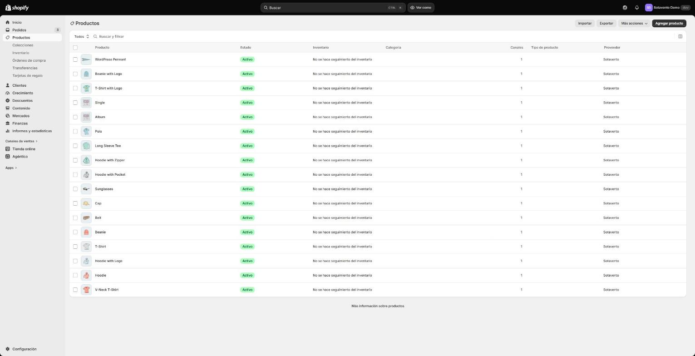
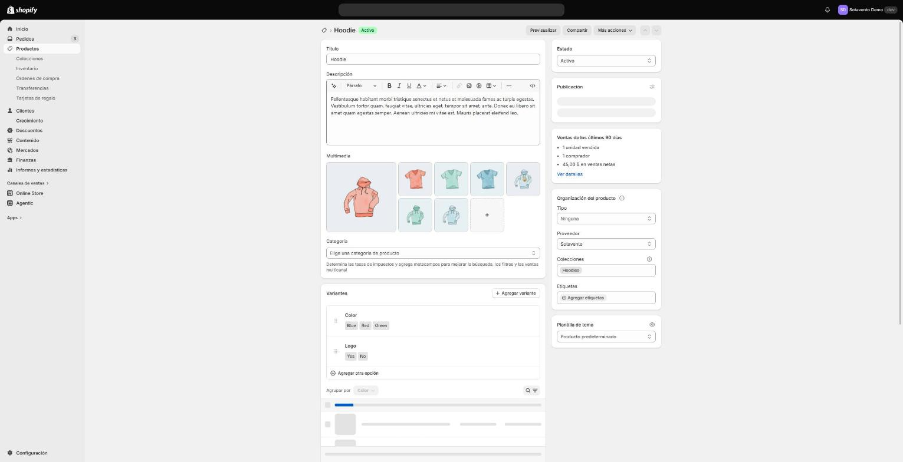
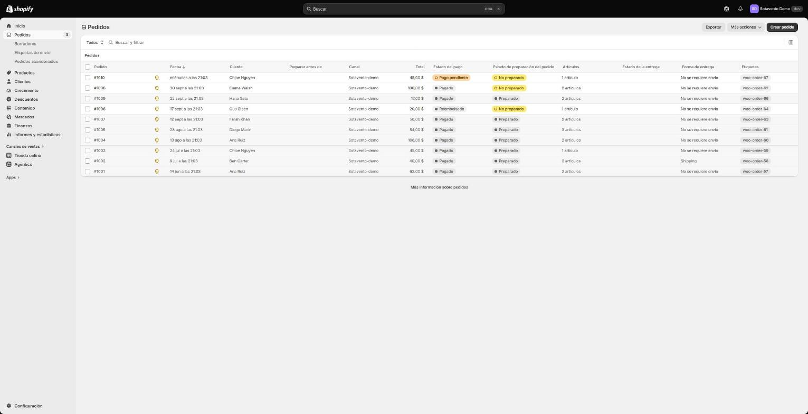
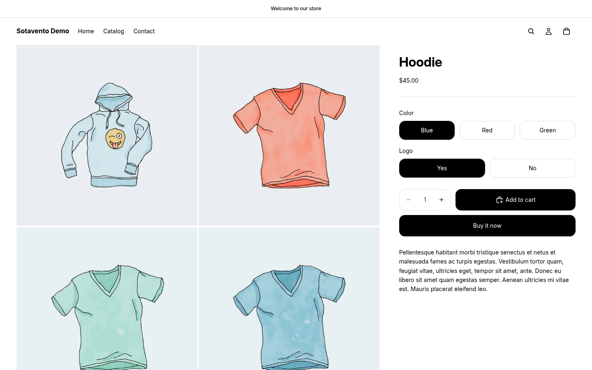

**What it is:** a test WooCommerce store ("Sotavento", with the sample catalog WooCommerce ships) migrated to a Shopify development store. I built it to show how I run a migration: what moves and how, what happens to every URL Google already knows, and how the domain switches over without taking email down. It isn't a client store: there are no sales or traffic to show off, only the process and its checks.

## 1. The source store

- WordPress 7 + WooCommerce in Docker, with Yoast SEO and permalinks like `/product/hoodie/`, as most real stores have.
- **18 products** (2 with variations, one grouped, one external), **6 categories**, **4 blog posts**, **4 pages**, **8 customers** and **10 orders** in different states (completed, processing, on hold, refunded). Every product, page and post has a meta description.
- Yoast's sitemap lists **38 URLs**. That's the list that has to survive.

## 2. What moved and how

Everything through Shopify's API with my own scripts: they can run again without duplicating anything.

| From WooCommerce | On Shopify | Detail |
|---|---|---|
| 17 products | 17 products, 28 variants | Handle = the old slug, same price, sales as a compare-at price |
| "Any size" variation | One variant per size | Shopify has no "any": the 3-variation tee becomes 9 variants |
| Grouped product | Collection | Shopify has no grouped products |
| External product | Product linking to the seller | |
| 6 categories | 6 collections | With their meta descriptions |
| 22 images | Uploaded to Shopify | Never hot-linked to `wp-content`: the old server gets switched off |
| 4 pages, 4 posts | Pages and a "News" blog | Original date and meta description |
| 8 customers | 8 customers | Name, email, phone and address |
| 10 orders | 10 historical orders | Original date, payment and fulfillment status, total and customer, with no confirmation emails sent and no inventory touched. Compared one by one with WooCommerce: 0 differences |

Shopify numbers orders from #1001; the WooCommerce number stays as a tag (`woo-order-57`) so it can be searched. One order for the "any size" tee matches none of the new variants, so it stays as a line with its original title, SKU and price: order history doesn't get rewritten.

To read and create customers through the API, Shopify requires the app to have approved access to protected customer data. Here I found that out halfway through; on a real store it's sorted before migration day.

**Doesn't move:** customer passwords (Shopify can't import them; each customer gets an invite to activate their account), payment data, reviews and coupons. With a real store, each of these is agreed before work starts.

## 3. 301 redirects

Every old URL points at its Shopify equivalent. The rules:

| WooCommerce URL | Shopify URL |
|---|---|
| `/product/hoodie/` | `/products/hoodie` |
| `/product-category/hoodies/` | `/collections/hoodies` |
| `/how-to-pick-a-hoodie-size/` (post) | `/blogs/news/how-to-pick-a-hoodie-size` |
| `/about/` (page) | `/pages/about` |
| `/category/style-notes/` | `/blogs/news` |
| `/shop/`, `/cart/`, `/checkout/`, `/my-account/` | `/collections/all`, `/cart`, `/cart`, `/account` |

The redirects go into Shopify through the same CSV you'd import by hand in the admin (*URL redirects › Import*), built from the handles Shopify actually assigned, not the ones expected: [download `redirects.csv`](/demo/migracion/redirects.csv).

<!-- CAPTURA_REDIRECTS -->

## 4. Before/after check

A script requests each of the 38 old URLs from the Shopify store, follows every redirect and compares the title and meta description with what WooCommerce had.

| Result | URLs |
|---|---|
| A single 301 to the right URL, page 200, same title and meta description | 29 |
| Shopify's own route (`/shop/`, `/cart/`, `/checkout/`): Shopify serves the page, the redirect doesn't apply | 3 |
| Correct 301, title changed on purpose: WordPress appends "Archives" to categories ("Hoodies Archives"); on Shopify it's "Hoodies" | 6 |
| **404** | **0** |

Full report, URL by URL: [download `reporte-migracion.csv`](/demo/migracion/reporte-migracion.csv).

What came out of the check rather than the plan: Shopify won't redirect `/cart/` (the route is its own) and answers `/shop` with the home page even though the redirect exists. Neither is a 404, but on a real store I'd flag it before the domain switch, not after.

## 5. Switching the domain without breaking email

DNS is where migrations usually take email down: the zone gets wiped, Shopify's records get pasted in and the MX records are gone. Here it's a dry run against the real `ivanaguirre.dev` zone, read without changing anything:

| Record | Now | After |
|---|---|---|
| `@` A | 2 Cloudflare IPs | `23.227.38.65` |
| `@` AAAA | 2 Cloudflare IPs | `2620:127:f00f:5::` |
| `www` A / AAAA | Cloudflare IPs | deleted |
| `www` CNAME | none | `shops.myshopify.com.` |

**Untouched, record by record:** the 3 mail MX records, SPF, the DKIM key, DMARC, Klaviyo's verification and the `send.ivanaguirre.dev` delegation to Klaviyo: 11 records. Shopify's records go in unproxied (grey cloud on Cloudflare).

Before the switch I save a snapshot of the zone; right after, a script reads it again and fails if any mail record changed. Today, against the live zone: `mail records unchanged`.

## 6. Price

A fixed price per migration, **$250 to $300** depending on catalog size, agreed in writing before work starts. It covers the catalog, customers, past orders, pages, blog, every redirect with its report, and the domain switch.

## 7. With a real store, next would be

- Pull the URLs that get traffic from Search Console, not just the sitemap; the ones with visits or backlinks get checked one by one.
- Redirect old `/wp-content/uploads/` images that have backlinks.
- Lower the DNS TTL a day ahead and switch during the slowest sales hours.
- If the store already emails its customers, set Klaviyo up on top: [here's how I do it](/en/demo/klaviyo/).
