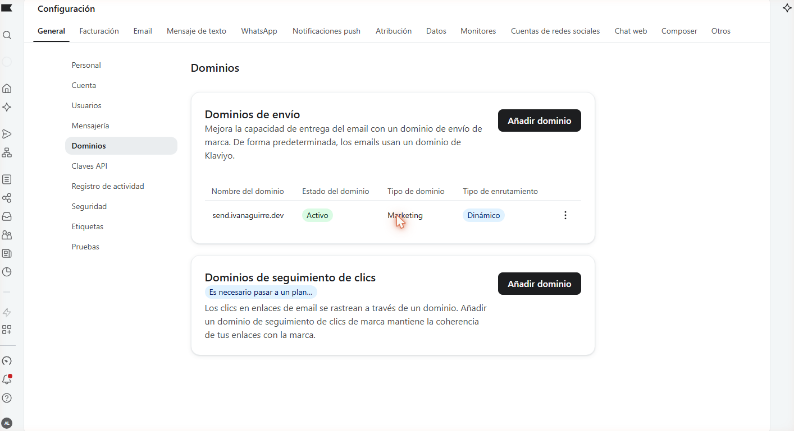
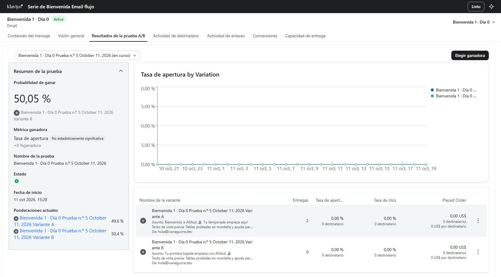
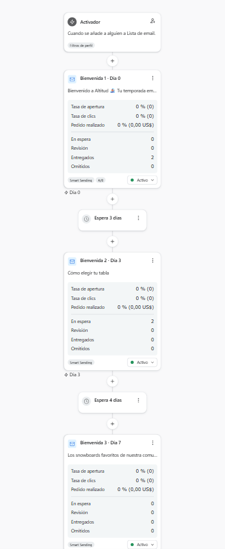
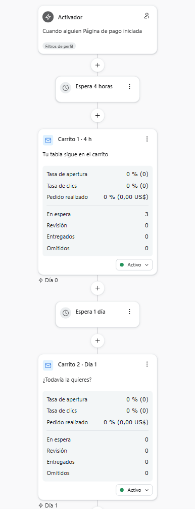
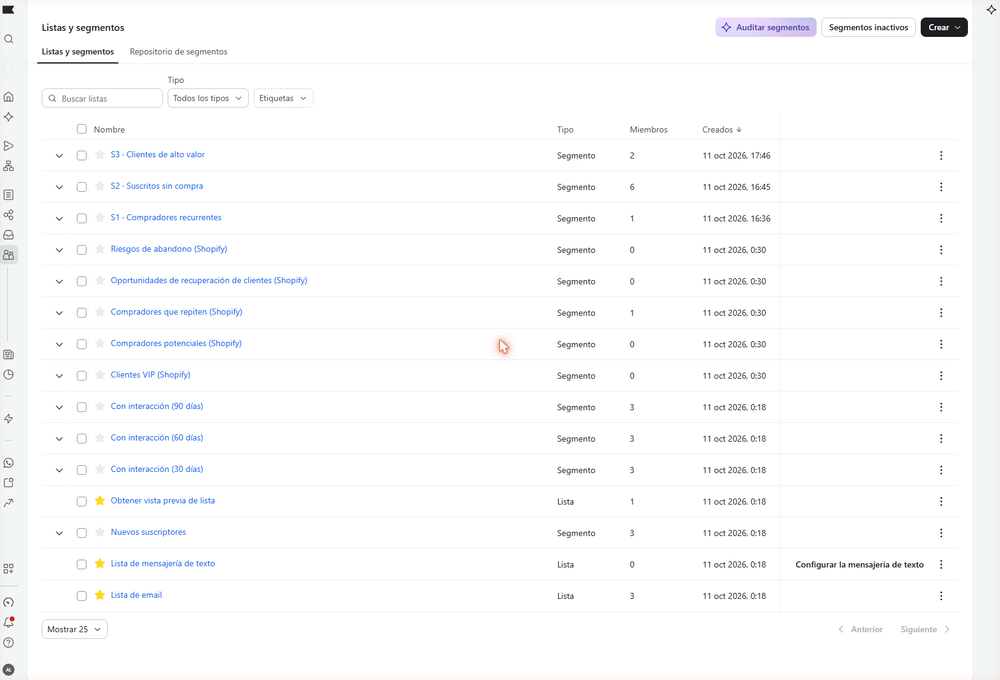
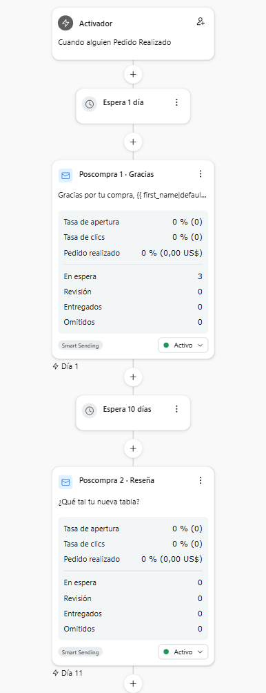

**Qué es:** una cuenta de Klaviyo conectada a una tienda de desarrollo de Shopify ("Altitud Snowboards", 17 tablas de datos de prueba). La monté para mostrar cómo trabajo: entregabilidad, flujos, segmentos y copy. No hay clientes reales, así que no hay métricas que presumir; lo que se ve es cómo está armado y por qué.

## 1. Entregabilidad

- **Dominio propio:** `ivanaguirre.dev` (Cloudflare).
- **Dominio de envío en Klaviyo:** `send.ivanaguirre.dev`, delegado a Klaviyo por NS; el SPF y el DKIM de Klaviyo quedan en mi dominio, no en el suyo. Estado: verificado y activo.

- **DMARC:** `p=none` publicado para empezar a recibir reportes; con reportes limpios, el siguiente paso es `p=quarantine`.

- **Remitente:** Altitud Snowboards `<hola@ivanaguirre.dev>`, un buzón real (Cloudflare Email Routing): si el cliente responde, alguien lo lee.

## 2. Flujos

### Serie de bienvenida (activo)
- **Disparador:** se suscribe a "Lista de email". **Filtro:** no ha hecho ningún pedido desde que entró al flujo. Quien compra sale de la serie.
- **Email 1 · día 0:** bienvenida y qué ofrece la tienda. **Prueba A/B de asunto:** A "Bienvenido a Altitud 🏂 Tu temporada empieza aquí" (marca) contra B "Tu primera bajada empieza con Altitud 🏂" (beneficio para el rider); gana la tasa de apertura.

- **Espera 3 días → Email 2:** "Cómo elegir tu tabla": tres criterios (medida, flex, terreno) dentro del correo, sin mandar a contenido que la tienda no tiene.
- **Espera 4 días → Email 3:** los más vendidos de los últimos 90 días con un bloque de producto dinámico del catálogo de Shopify.

### Carrito abandonado (activo)
- **Disparador:** inicia el pago (Started Checkout). **Filtro:** no ha hecho ningún pedido desde que entró al flujo; si compra, no recibe recordatorios.
- **Espera 4 horas → C1:** su carrito (bloque dinámico del evento) y botón que regresa a su checkout.
- **Espera 1 día → C2:** el carrito otra vez y, debajo, los más pedidos de la temporada. (En la vista previa el bloque del carrito sale vacío porque no hay un evento real; en un envío los productos aparecen entre los dos botones.)
- Quité la rama de SMS de la plantilla: la tienda no tiene consentimiento de SMS configurado. Quité también el banner "envío gratis en compras de $50": la tienda no tiene esa política.

### Poscompra (activo)
- **Disparador:** pedido realizado. **Espera 1 día → P1:** gracias y a quién escribir si algo sale mal.
- **Espera 10 días → P2:** pide su opinión respondiendo el correo (tiempo para recibir la tabla y usarla).

## 3. Segmentos
- **Compradores recurrentes:** 2 o más pedidos, en todo el historial. Hoy: 1 perfil de prueba.
- **Suscritos sin compra:** en la lista y sin ningún pedido. Hoy: 6 (mis dos perfiles de prueba, mi correo y 3 clientes de ejemplo que crea Shopify en tiendas de desarrollo).
- **Clientes de alto valor:** han gastado 800 US$ o más en total (suma de lo que han pedido). En esta cuenta Klaviyo no deja filtrar por el total de un pedido ni ofrece valor de vida del cliente, así que el segmento usa la suma de productos pedidos. Hoy: 2 perfiles (1,299.95 y 1,025 US$).

## 4. Cómo escribí los correos
- Nada que la tienda no cumpla: ni descuentos, ni envío gratis, ni contenido inexistente.
- Personalización con respaldo: `{{ first_name|default:'rider' }}`, así nadie recibe "Hola ,".
- Máximo un emoji por asunto. Cada correo invita a responder: el remitente es un buzón real.
- Pie con la línea de contacto y el bloque de baja y dirección que exige la ley. En bienvenida y carrito lo traduje; en poscompra la plantilla usa etiquetas fijas de Klaviyo que quedan en inglés.

## 5. Pruebas
Perfiles de prueba con alias de mi propio correo, en la tienda de desarrollo y con la pasarela de prueba de Shopify:
- **cliente1 y cliente2** se suscriben a la lista (el tema de la tienda no trae formulario de suscripción, así que los agregué desde Klaviyo con el consentimiento marcado). Recibieron el email 1 de bienvenida; el email 2 está en espera de su día 3.
- **cliente2** inicia el pago de una tabla y lo deja. Entra al flujo de carrito.
- **cliente3** hace 2 pedidos y **cliente4** uno de 1,025 US$. Entran a poscompra (3 en espera del día 1) y a los segmentos de recurrentes y de alto valor. Sus checkouts también entraron al flujo de carrito; el filtro de "sin pedidos" está ahí para sacarlos antes del envío, porque ya compraron.

## 6. Con una tienda real, lo siguiente sería
- Medir clics y pedidos atribuidos, no solo aperturas (Apple Mail infla las aperturas).
- Flujos de producto visto sin compra, recuperación de clientes inactivos y limpieza de la lista.
- SMS o WhatsApp solo con consentimiento explícito.
- DMARC a `p=quarantine` cuando los reportes estén limpios.

## 7. Lo que se lleva tu tienda
- **Correos desde tu propio dominio**, firmados con SPF y DKIM, en lugar de un remitente compartido. Eso ayuda a que lleguen a la bandeja de entrada y no a spam.
- **Bienvenida, carrito abandonado y poscompra funcionando solos**, con la voz de tu marca, y quien compra deja de recibir recordatorios. Las confirmaciones de pedido y de envío siguen saliendo de Shopify.
- **Segmentos listos para campañas:** compradores recurrentes, suscritos que nunca han comprado y clientes de alto valor.

Lo armo en la cuenta de Klaviyo de tu tienda por 150 US$, precio fijo: los tres flujos, los segmentos y la revisión del dominio de envío. Si eres agencia, lo hago en la cuenta de tu cliente y con tu nombre. [Escríbeme](/#contact) y cuéntame qué tienes funcionando hoy.
