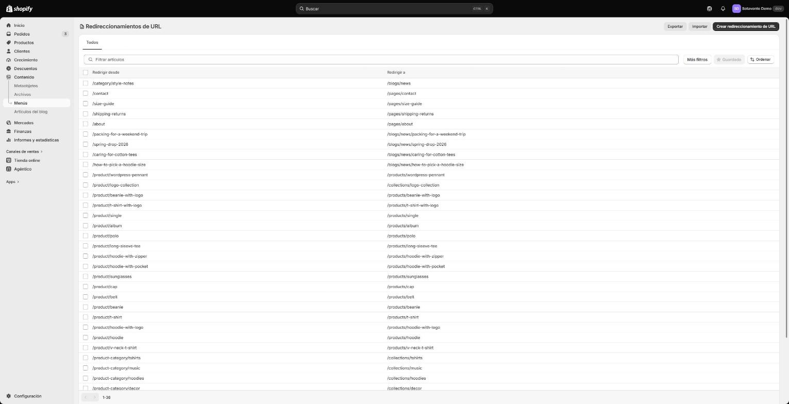

Soy Ivan, desarrollador web en Veracruz, México. Esta es una tienda WooCommerce de prueba ("Sotavento", con el catálogo de ejemplo que trae WooCommerce) que migré a una tienda de desarrollo de Shopify para mostrar cómo trabajo una migración: qué se mueve y cómo, qué pasa con cada URL que Google ya conoce y cómo se cambia el dominio sin que se caiga el correo. La tienda no tiene ventas reales; lo que se ve es el proceso y sus comprobaciones.

## 1. Para qué le sirve a una tienda
- **Catálogo, clientes y pedidos completos en Shopify**, con imágenes, variantes y fechas originales. Productos y clientes se cuentan contra la tienda vieja; los pedidos se comparan uno por uno.
- **Ninguna URL vieja da 404:** cada página que Google ya conoce redirige con una 301 a su equivalente y conserva su título y meta descripción. Se comprueba URL por URL (aquí, 38) y el reporte es tuyo.
- **El dominio cambia sin tocar el correo:** los registros MX, SPF, DKIM y DMARC quedan igual y nadie deja de recibir correo. Un script lo verifica justo después del cambio.

## 2. La tienda de origen

- WordPress 7 + WooCommerce, con Yoast SEO y enlaces permanentes del tipo `/product/hoodie/`, como la mayoría de las tiendas reales.
- **18 productos** (2 con variantes, uno agrupado y uno externo), **6 categorías**, **4 artículos de blog**, **4 páginas**, **8 clientes** y **10 pedidos** con estados distintos (completado, en proceso, en espera, reembolsado). Cada producto, página y artículo tiene su meta descripción.
- El sitemap de Yoast lista **38 URLs**. Esa es la lista que se tiene que conservar.

## 3. Qué se movió y cómo

Todo por la API de Shopify con scripts propios, que se pueden correr otra vez sin duplicar nada: una última corrida justo antes del cambio de dominio trae los pedidos y clientes que llegaron mientras tanto.

| De WooCommerce | En Shopify | Detalle |
|---|---|---|
| 17 productos (el 18, agrupado, va abajo) | 17 productos, 28 variantes | Mismo handle que el slug viejo, mismo precio, rebajas como precio tachado |
| Variación "cualquier talla" | Una variante por talla | Shopify no tiene "cualquiera": la camiseta de 3 variaciones queda en 9 variantes |
| Producto agrupado | Colección | Shopify no tiene productos agrupados |
| Producto externo | Producto con enlace al vendedor | |
| 6 categorías | 6 colecciones | Con su meta descripción |
| 22 imágenes | Subidas a Shopify | Nunca enlazadas a `wp-content`: el servidor viejo se apaga |
| 4 páginas, 4 artículos | Páginas y blog "News" | Meta descripción en todos; los artículos conservan su fecha original |
| 8 clientes | 8 clientes | Nombre, correo, teléfono y dirección |
| 10 pedidos | 10 pedidos históricos | Fecha, estado de pago y de envío, total y cliente originales, sin mandar correos de confirmación ni tocar inventario. Comparados uno por uno con WooCommerce: 0 diferencias ([`orders-compare.csv`](/demo/migracion/orders-compare.csv)) |

Shopify numera los pedidos desde el #1001; el número de WooCommerce queda como etiqueta (`woo-order-57`) para buscarlo. Un pedido de la camiseta "cualquier talla" no corresponde a ninguna de las variantes nuevas, así que queda como línea con su título, SKU y precio originales: el historial no se reescribe.

**No se mueve:** contraseñas de clientes (Shopify no las importa: cada cliente vuelve a entrar con su correo, con un código o una invitación según el tipo de cuenta de la tienda, y no se le manda nada hasta que el dueño lo decide), datos de pago, reseñas y cupones. Con una tienda real, cada uno de estos se acuerda antes de empezar.

## 4. Redirecciones 301

Cada URL vieja apunta a su equivalente en Shopify. Las reglas:

| URL de WooCommerce | URL en Shopify |
|---|---|
| `/product/hoodie/` | `/products/hoodie` |
| `/product-category/hoodies/` | `/collections/hoodies` |
| `/how-to-pick-a-hoodie-size/` (artículo) | `/blogs/news/how-to-pick-a-hoodie-size` |
| `/about/` (página) | `/pages/about` |
| `/category/style-notes/` | `/blogs/news` |
| `/shop/`, `/cart/`, `/checkout/`, `/my-account/` | `/collections/all`, `/cart`, `/cart`, `/account` |

Las redirecciones entran a Shopify con el mismo CSV que se importa a mano desde el panel (*Redireccionamientos de URL › Importar*), generado con los handles que Shopify asignó de verdad: [descargar `redirects.csv`](/demo/migracion/redirects.csv).

## 5. Comprobación antes y después

Un script pide cada una de las 38 URLs viejas a la tienda de Shopify, sigue cada redirección y compara título y meta descripción con lo que tenía WooCommerce.

| Resultado | URLs |
|---|---|
| Una sola 301 a la URL correcta, página 200, mismo título y meta descripción (la portada, `/`, responde directo) | 29 |
| Ruta propia de Shopify (`/shop/`, `/cart/`, `/checkout/`): Shopify responde la página, la redirección no aplica | 3 |
| 301 correcta, título cambiado a propósito: WordPress agrega "Archives" a las categorías ("Hoodies Archives"); en Shopify queda "Hoodies" | 6 |
| **404** | **0** |

Reporte completo, URL por URL: [descargar `reporte-migracion.csv`](/demo/migracion/reporte-migracion.csv).

Lo que salió de la comprobación y no del plan: Shopify no deja redirigir `/cart/` (la ruta ya es suya) y responde `/shop` con la página de inicio aunque la redirección exista. Ninguna de las dos da 404, y en una tienda real lo aviso antes del cambio de dominio.

## 6. Cambio de dominio sin romper el correo

El cambio de DNS es donde una migración suele tumbar el correo: se borra la zona, se pega la de Shopify y los MX desaparecen. Aquí es un simulacro sobre la zona real de `ivanaguirre.dev`, leída sin modificar nada:

| Registro | Ahora | Después |
|---|---|---|
| `@` A | 2 IPs de Cloudflare | `23.227.38.65` |
| `@` AAAA | 2 IPs de Cloudflare | `2620:127:f00f:5::` |
| `www` A / AAAA | IPs de Cloudflare | se borran |
| `www` CNAME | no existe | `shops.myshopify.com.` |

**Se quedan igual, registro por registro:** los 3 MX del correo, el SPF, la llave DKIM, DMARC, la verificación de Klaviyo y la delegación de `send.ivanaguirre.dev` a Klaviyo: 11 registros. Los de Shopify van sin proxy de Cloudflare (nube gris).

Antes del cambio guardo una foto de la zona; justo después, un script la vuelve a leer y falla si cualquier registro de correo cambió. Como en este simulacro no se cambió nada, hoy solo prueba que el script lee la zona real y la compara: `mail records unchanged`.

## 7. Con una tienda real, lo siguiente sería
- Sacar las URLs con tráfico de Search Console, no solo del sitemap: las que tienen visitas o enlaces externos se revisan una por una.
- Redirigir las imágenes viejas de `/wp-content/uploads/` que tengan enlaces externos.
- Si la tienda ya manda correos a sus clientes, conectar Klaviyo encima: [así lo monto](/demo/klaviyo/).

## 8. Cómo es trabajar conmigo
- **Acceso:** me das un usuario administrador en WordPress y aceptas una solicitud de colaborador en Shopify (el código de 4 dígitos está en *Configuración › Usuarios › Seguridad*). Si Shopify pide aprobar el acceso a datos de clientes, lo resuelvo antes del día del cambio. Para el DNS, me das acceso a tu proveedor o te paso la lista exacta de registros y tú la aplicas. Nunca necesito tu contraseña.
- **El día del cambio:** 12 horas antes se congelan los cambios en la tienda vieja; corro la última importación, entran las redirecciones y te llega el reporte al correo. El DNS se cambia en el horario de menos ventas, con el TTL bajado un día antes, y la revisión del correo va justo después. La tienda vieja sigue en línea 14 días: si algo falla, se regresa el DNS y listo. La migración está terminada cuando cada URL del reporte está bien o explicada. Entrega en 5 días hábiles desde que tengo los accesos.
- **Agencias:** trabajo dentro de la cuenta de tu cliente, no lo contacto a menos que me lo pidas, y tú le entregas un documento como esta página con tu nombre.
- **Respuesta:** contesto en menos de 24 horas, en español o en inglés. Mi jornada coincide con el horario de oficina de Estados Unidos.

Migro tu tienda de WooCommerce a Shopify por 300 US$, precio fijo, hasta 200 productos (con sus variantes) y 1,000 pedidos: productos, clientes, pedidos históricos, páginas, blog, todas las redirecciones con su reporte y el cambio de dominio. Si tu tienda es más grande, te doy un precio fijo antes de empezar, a partir de su exportación. No incluye el diseño del tema ni la configuración de pagos, envíos e impuestos (se hacen en Shopify con la cuenta del dueño o se cotizan aparte). Escríbeme a [hola@ivanaguirre.dev](mailto:hola@ivanaguirre.dev?subject=Migración) con "Migración" en el asunto, el link de tu tienda y más o menos cuántos productos y pedidos tiene.
