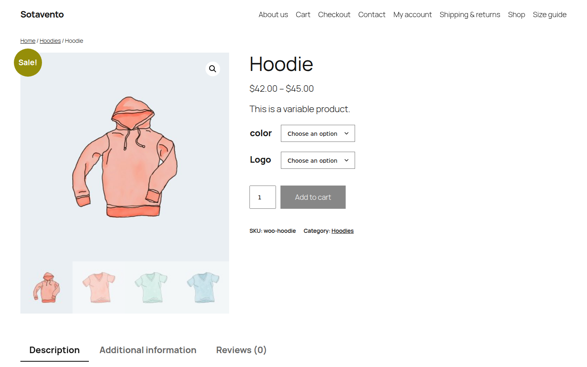

**Qué es:** una tienda WooCommerce de prueba ("Sotavento", con el catálogo de ejemplo que trae WooCommerce) migrada a una tienda de desarrollo de Shopify. La monté para mostrar cómo trabajo una migración: qué se mueve y cómo, qué pasa con cada URL que Google ya conoce y cómo se cambia el dominio sin que se caiga el correo. No es una tienda de cliente: no hay ventas ni tráfico que presumir, solo el proceso y sus comprobaciones.

## 1. La tienda de origen

- WordPress 7 + WooCommerce en Docker, con Yoast SEO y enlaces permanentes del tipo `/product/hoodie/`, como la mayoría de las tiendas reales.
- **18 productos** (2 con variantes, uno agrupado y uno externo), **6 categorías**, **4 artículos de blog**, **4 páginas**, **8 clientes** y **10 pedidos** con estados distintos (completado, en proceso, en espera, reembolsado). Cada producto, página y artículo tiene su meta descripción.
- El sitemap de Yoast lista **38 URLs**. Esa es la lista que se tiene que conservar.

## 2. Qué se movió y cómo

Todo por la API de Shopify con scripts propios: se puede correr otra vez sin duplicar nada.

| De WooCommerce | En Shopify | Detalle |
|---|---|---|
| 17 productos | 17 productos, 28 variantes | Mismo handle que el slug viejo, mismo precio, rebajas como precio tachado |
| Variación "cualquier talla" | Una variante por talla | Shopify no tiene "cualquiera": la camiseta de 3 variaciones queda en 9 variantes |
| Producto agrupado | Colección | Shopify no tiene productos agrupados |
| Producto externo | Producto con enlace al vendedor | |
| 6 categorías | 6 colecciones | Con su meta descripción |
| 22 imágenes | Subidas a Shopify | Nunca enlazadas a `wp-content`: el servidor viejo se apaga |
| 4 páginas, 4 artículos | Páginas y blog "News" | Fecha original y meta descripción |
| 8 clientes | 8 clientes | Nombre, correo, teléfono y dirección |
| 10 pedidos | 10 pedidos históricos | Fecha, estado de pago y de envío, total y cliente originales, sin mandar correos de confirmación ni tocar inventario. Comparados uno por uno con WooCommerce: 0 diferencias |

Shopify numera los pedidos desde el #1001; el número de WooCommerce queda como etiqueta (`woo-order-57`) para buscarlo. Un pedido de la camiseta "cualquier talla" no corresponde a ninguna de las variantes nuevas, así que queda como línea con su título, SKU y precio originales: el historial no se reescribe.

Para leer y crear clientes por API, Shopify exige que la app tenga aprobado el acceso a datos protegidos de clientes. Aquí lo descubrí a medio camino; con una tienda real se resuelve antes del día de la migración.

**No se mueve:** contraseñas de clientes (Shopify no importa contraseñas; cada cliente recibe una invitación para activar su cuenta), datos de pago, reseñas y cupones. Con una tienda real, cada uno de estos se acuerda antes de empezar.

## 3. Redirecciones 301

Cada URL vieja apunta a su equivalente en Shopify. Las reglas:

| URL de WooCommerce | URL en Shopify |
|---|---|
| `/product/hoodie/` | `/products/hoodie` |
| `/product-category/hoodies/` | `/collections/hoodies` |
| `/how-to-pick-a-hoodie-size/` (artículo) | `/blogs/news/how-to-pick-a-hoodie-size` |
| `/about/` (página) | `/pages/about` |
| `/category/style-notes/` | `/blogs/news` |
| `/shop/`, `/cart/`, `/checkout/`, `/my-account/` | `/collections/all`, `/cart`, `/cart`, `/account` |

Las redirecciones entran a Shopify con el mismo CSV que se importa a mano desde el panel (*URL redirects › Importar*), generado a partir de lo que Shopify asignó de verdad, no de lo que se esperaba: [descargar `redirects.csv`](/demo/migracion/redirects.csv).

<!-- CAPTURA_REDIRECTS -->

## 4. Comprobación antes y después

Un script pide cada una de las 38 URLs viejas a la tienda de Shopify, sigue cada redirección y compara título y meta descripción con lo que tenía WooCommerce.

| Resultado | URLs |
|---|---|
| Una sola 301 a la URL correcta, página 200, mismo título y meta descripción | 29 |
| Ruta propia de Shopify (`/shop/`, `/cart/`, `/checkout/`): Shopify responde la página, la redirección no aplica | 3 |
| 301 correcta, título cambiado a propósito: WordPress agrega "Archives" a las categorías ("Hoodies Archives"); en Shopify queda "Hoodies" | 6 |
| **404** | **0** |

Reporte completo, URL por URL: [descargar `reporte-migracion.csv`](/demo/migracion/reporte-migracion.csv).

Lo que salió de la comprobación y no del plan: Shopify no deja redirigir `/cart/` (la ruta ya es suya) y responde `/shop` con la página de inicio aunque la redirección exista. Ninguna de las dos da 404, pero en una tienda real lo digo antes del cambio de dominio, no después.

## 5. Cambio de dominio sin romper el correo

El cambio de DNS es donde una migración suele tumbar el correo: se borra la zona, se pega la de Shopify y los MX desaparecen. Aquí es un simulacro sobre la zona real de `ivanaguirre.dev`, leída sin modificar nada:

| Registro | Ahora | Después |
|---|---|---|
| `@` A | 2 IPs de Cloudflare | `23.227.38.65` |
| `@` AAAA | 2 IPs de Cloudflare | `2620:127:f00f:5::` |
| `www` A / AAAA | IPs de Cloudflare | se borran |
| `www` CNAME | no existe | `shops.myshopify.com.` |

**Se quedan igual, registro por registro:** los 3 MX del correo, el SPF, la llave DKIM, DMARC, la verificación de Klaviyo y la delegación de `send.ivanaguirre.dev` a Klaviyo: 11 registros. Los de Shopify van sin proxy de Cloudflare (nube gris).

Antes del cambio guardo una foto de la zona; justo después, un script la vuelve a leer y falla si cualquier registro de correo cambió. Hoy, contra la zona real: `mail records unchanged`.

## 6. Precio

Precio fijo por migración, **de 250 a 300 US$** según el tamaño del catálogo, acordado por escrito antes de empezar. Incluye catálogo, clientes, pedidos históricos, páginas, blog, todas las redirecciones con su reporte y el cambio de dominio.

## 7. Con una tienda real, lo siguiente sería

- Sacar las URLs con tráfico de Search Console, no solo del sitemap: las que tienen visitas o enlaces externos se revisan una por una.
- Redirigir las imágenes viejas de `/wp-content/uploads/` que tengan enlaces externos.
- Bajar el TTL del DNS un día antes y hacer el cambio en el horario de menos ventas.
- Si la tienda ya manda correos a sus clientes, conectar Klaviyo encima: [así lo monto](/demo/klaviyo/).
